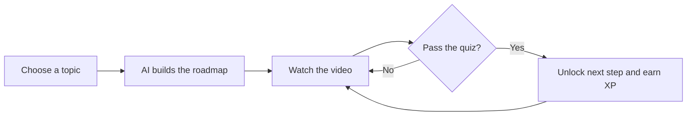
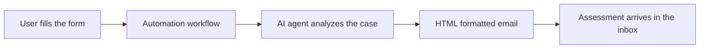

 

 

## 👋 About Me

I am an **AI Engineering student** who turns ideas into working products. I build applications powered by large language models, retrieval-augmented generation (RAG) pipelines and multi-agent systems, then ship them as complete full-stack products that real people can use.

| | |
|---|---|
| 🎓 **Studying** | AI Engineering at Minia National University, Faculty of Computers and Information (since 2024) |
| 💼 **Working as** | Freelance AI Engineer and Full-Stack Developer |
| 🌍 **Based in** | Egypt |
| 🧠 **Focus** | LLM applications, RAG, multi-agent systems, AI automation |
| 📫 **Reach me** | martinnabil999@gmail.com |

 

## 🛠️ Tech Stack

**AI and LLM**

**Languages, frameworks and tools**

 

## 🚀 Featured Projects

### 🎓 NEXORA Smart Platform
*Tell it what you want to learn and get a complete roadmap from the basics to professional level.*

- 🗺️ AI-generated learning roadmap for any topic, with embedded videos for every step
- ✅ A quiz after every video, and you must pass it to unlock the next one
- 🏆 Levels, a leaderboard that shows who is leading, and badges and rewards for top performers
- 💾 Roadmaps, messages and progress are stored on a server per user, so nothing is lost when you log out and come back

🔗 [**View source code**](https://github.com/MARTIN1262/NEXORA-PLATFORM)

---

### 💬 Real-time Chat Application
*A full-featured messaging app where messages arrive instantly, with productivity tools built in.*

- ⚡ Real-time messaging between users with instant delivery
- 🔎 Add friends by searching their username
- 📝 Dedicated tasks page to organize your day
- 🍅 Dedicated study page using the Pomodoro technique
- 🛡️ Admin system: an admin account can ban a user or suspend their account completely when rules are broken
- ☁️ Firebase used as the backend to store all conversations

🔗 [**View source code**](https://github.com/MARTIN1262/Real-time-chat-application)

---

### 🩺 Medical Assistant Form
*Describe your symptoms and receive an AI-written preliminary assessment in your inbox.*

- 📋 A form that collects symptoms, current medication, chronic conditions and your email
- 🤖 An AI agent inside an automation workflow analyzes the answers and writes the assessment
- 💊 The email includes the likely diagnosis and suggested medication
- 🎨 The message is formatted with HTML and ends with a custom signature
- ⚠️ Always ends with a reminder to consult a doctor

> This project is a demonstration and not a substitute for professional medical advice.

🔗 [**View source code**](https://github.com/MARTIN1262/medical-form)

---

### 🪲 Al-Thiqa: Pest Control Websites (Client Project)
*Complete business websites for a pest control company, built twice because the client came back for a second one.*

- 🌐 Full website with a backend that connects customers directly with the business
- 🎯 Clean, smooth interface that presents the services clearly and makes it easy for visitors to get started
- 🔁 Repeat client: two separate versions delivered, each with its own focus

🔗 [**Version 1**](https://github.com/MARTIN1262/Project-al-thiqa) · [**Version 2**](https://github.com/MARTIN1262/project-al-theqaa)

---

### 🎨 Personal Portfolio
*My first project ever, built with Next.js and smooth animations.*

- ✨ Modern animated interface
- 📬 Contact form that delivers each client message straight to my email
- 🚀 Deployed on Vercel

🔗 [**Live site**](https://martin-nabil-1.vercel.app) · [**Source code**](https://github.com/MARTIN1262/portfolio-)

 

## 💼 What I Can Build For You

| Service | What you get |
|---|---|
| 🤖 **AI chatbots and agents** | Assistants powered by the OpenAI API and multi-agent systems that handle real tasks |
| 📚 **RAG knowledge systems** | A chatbot that answers questions from your own documents and data |
| ⚙️ **AI automation** | Workflows that read input, think with an LLM and act, such as emailing a formatted report |
| 🌐 **Business websites** | Fast, clean, responsive websites with a backend and a working contact flow |
| 💬 **Real-time web apps** | Chat, dashboards and live features built on Firebase |

 

## 🌱 Currently

- 🔭 Building a **RAG-based AI knowledge system** that runs on local LLMs with Ollama
- 🌱 Exploring **Groq** and **Telegram** deployment for AI assistants
- 🎯 Deepening my knowledge of **multi-agent systems** with AutoGen
- 🤝 Open to **freelance projects** and collaborations

 

<!--
GitHub stats (optional, enable later when your activity grows):

-->

## 📫 Let's Work Together

Have an idea, a business that needs a website, or a problem that AI can solve? Send me a message and let us build it.

